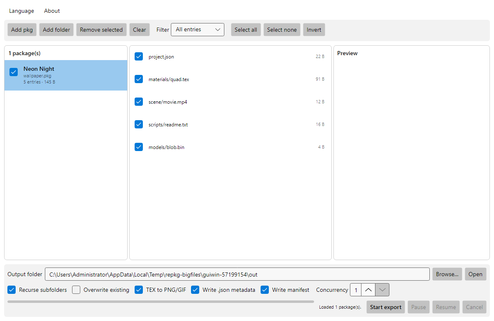
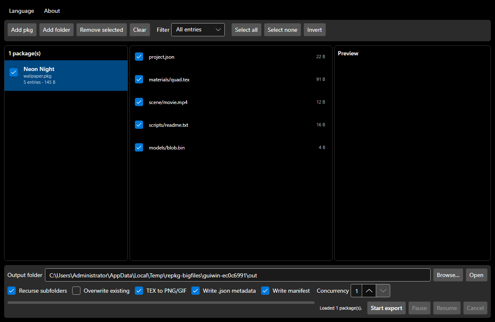
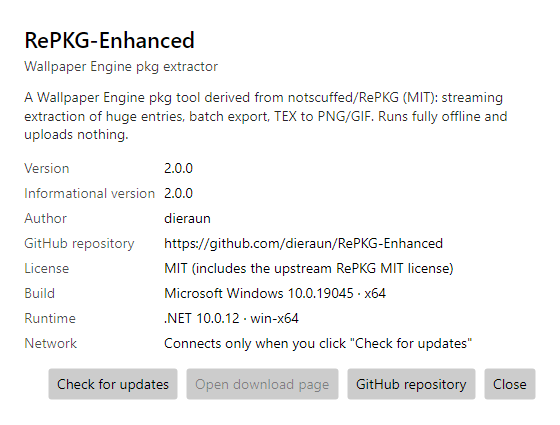

# RePKG-Enhanced

**English** | [简体中文](README.zh-CN.md)

**A Wallpaper Engine `.pkg` extractor: huge files don't crash, batches don't stall, memory stays bounded.**

[](https://github.com/dieraun/RePKG-Enhanced/releases)
[](https://github.com/dieraun/RePKG-Enhanced/actions/workflows/release.yml)
[](LICENSE)
[](#download)
[](https://dotnet.microsoft.com/)

Built on [notscuffed/RePKG](https://github.com/notscuffed/RePKG) (MIT, no longer maintained) with **the minimum necessary changes**: fix the root cause of its "large file extraction fails" behaviour, and add a cross-platform Avalonia desktop UI.
There is exactly one parser core and one export queue — **the CLI and the GUI share both**.



---

## Why this exists

Wallpaper Engine workshop packages are routinely hundreds of megabytes to several gigabytes, and the original RePKG does this while parsing a pkg:

```csharp
private static void PopulateEntriesWithData(int dataStart, List<PackageEntry> entries, BinaryReader reader)
{
    foreach (var entry in entries)
    {
        reader.BaseStream.Seek(entry.Offset + dataStart, SeekOrigin.Begin);
        entry.Bytes = reader.ReadBytes(entry.Length);   // ← every entry of the whole package, eagerly
    }
}
```

So **extracting a single 5 MB texture first pulls the entire 2 GB package into memory** — a 32-bit process dies with OOM, a 64-bit one thrashes the page file, and large entries are read from the wrong offset because the `int` arithmetic truncates.

RePKG-Enhanced **separates the entry table from the data region**: reading the table only records `FullPath / Offset / Length`, and extraction seeks to the entry offset and **streams** it to the destination through a 1 MiB buffer. Peak memory is a function of the buffer size and is **independent of entry size and of total package size**.

### Measured

On the development machine (Windows 10, 7.9 GB RAM, SSD), with the `REPKG_BIG_TESTS=1` gate enabled:

| Scenario | Package size | Extraction time | Managed allocation delta | Peak working set | Output check |
|---|---|---|---|---|---|
| Single 1 GiB entry | 1,073,741,867 B | 14.1 s | **1.0 MiB** | 40.2 MiB | SHA-256 matches the source byte for byte |
| Two 1.1 GiB entries | 2,362,232,074 B | 20.9 s | **1.0 MiB** | 42.3 MiB | same as above |

That 1.0 MiB is the first buffer rented from `ArrayPool`; **a larger package does not make it grow**. On the original code path the same scenario needs memory on the order of the entry size, and a 2.2 GiB package cannot work in a 32-bit process at all.

<details>
<summary>What the gate actually asserts (click to expand)</summary>

```csharp
// Extract a 1 GiB entry and assert the managed allocation delta does not scale with entry size
var before = GC.GetTotalAllocatedBytes(precise: true);
EntryExtractor.CopyEntry(source, entry, destination, bufferSize: 1 << 20);
var allocated = GC.GetTotalAllocatedBytes(precise: true) - before;
Assert.True(allocated < 32 * 1024 * 1024);   // measured: 1.0 MiB
```

Working set is printed but never asserted — on a 7.9 GB machine it is perturbed by the OS file cache and GC policy, and gating on it would produce a flaky test.
</details>

---

## Highlights

### 1. Large files first — entries never enter memory
- Entry table and data region are separated; `ReadBytes(entry.Length)` is gone from the whole extraction path (verifiable with `grep`).
- A single entry is extracted via `FileStream.Seek` plus a 1 MiB chunked copy; the entry stream is implemented on `RandomAccess.Read`, so several consumers can read the same handle in parallel.
- Source packages are opened with `FileAccess.Read` + `FileShare.Read`, so other readers are **not locked out**.
- Offsets are interpreted as **uint32** and held as `long` internally, fixing the original `int` truncation on packages larger than 2 GiB.

### 2. Batch export: one queue, failures isolated
- Directory recursion plus extension filtering (`-e/--onlyexts`, `-i/--ignoreexts`, same semantics as the original, `ignore` wins).
- A single bounded export queue (`System.Threading.Channels`); concurrency and queue capacity are both configurable, and **only one streaming read handle per file is alive at any moment**.
- A failing entry is logged and skipped; the failure count feeds the summary and the exit code, and one corrupt package does not sink the batch.
- Pause/cancel take effect at **entry boundaries**; cancelling removes temporary files, and already finished entries are kept by default.
- Output is written **atomically** (temp file in the same directory, then `File.Move`), so an interruption never leaves a half-written target.

### 3. TEX / GIF / MP4: extraction and preview
| Input | Output | Notes |
|---|---|---|
| `TEX` (RGBA8888 / R8 / RG88 / DXT1·3·5 / LZ4) | `PNG` | Decoded with SkiaSharp; pixels are cropped to the header size from the top-left in `TexToImageConverter` |
| Animated `TEX` (`TEXS0001-0003` frame tables) | `GIF` | **Self-written GIF89a encoder** (LZW + median-cut quantisation + per-frame local colour tables); frames are composed, written and freed one at a time — never all materialised |
| Video texture (`FIF_MP4`) | `MP4` | Validated against `ftypisom/ftypmsnv/ftypmp42`, then passed through |
| Any image container format (`FIF_PNG` etc.) | as-is | Bytes are passed straight through |
| Every TEX | `.json` | Wallpaper Engine texture metadata (`format`, flags, GIF sequence info) |

`--no-tex-convert` disables conversion and exports the raw `.tex` — **use it for very large entries**: TEX conversion has to buffer that entry in memory (250 MB per-entry cap), while the pure streaming path has no such limit.

### 4. GUI (Avalonia 12)
- Load one or many packages, or drag and drop them; three panes: packages, entries, preview.
- **Tri-state checkboxes** (all / partial / none) propagate both ways, and entries can be filtered by image / text / video / other.
- Preview: TEX is rendered as an image, text files are shown with a 64 KiB truncation notice, videos get an explanatory note.
- Export runs on **the exact same queue and streaming core as the CLI**, so pause, cancel, failure isolation and progress all come for free — there is no second implementation.
- Light/dark theme follows the system; all XAML is compiled into the binary (an AOT requirement); no animations, no cloud sync.



### 5. Bilingual UI, About, and a manual update check (2.0)
- The **GUI and the CLI are fully bilingual (Simplified Chinese / English)**. On first start the language follows the system setting; afterwards your choice is remembered in `%APPDATA%\RePKG-Enhanced\settings.json`.
- Switching the language in the GUI takes effect **immediately** — no restart: every label is a `DynamicResource` looked up in a dictionary that is swapped on the fly.
- The CLI picks the language from `--lang zh|en`, then `REPKG_LANG`, then `settings.json`, then the system. `repkg --lang en --help` prints the English help.
- **About** shows the build version, informational version, author, repository, license and runtime, and has a **Check for updates** button that compares against the latest GitHub release.
- **Everything stays offline by default**: nothing ever touches the network at startup. Only that button (or `repkg --check-update`) performs a single request to the GitHub API.



### 6. Single file, zero dependencies
`repkg.exe` (~14 MiB) and `RePKG-Enhanced.exe` (~35 MiB) are **NativeAOT single files**: the .NET runtime plus the SkiaSharp / HarfBuzz / ANGLE native libraries are all embedded, so they just run — no .NET installation on the target machine.

---

## Download

Grab the latest Windows x64 build from [Releases](https://github.com/dieraun/RePKG-Enhanced/releases/latest):

| File | Description |
|---|---|
| `RePKG-Enhanced-win-x64.exe` | Graphical version (~35 MiB) |
| `repkg-win-x64.exe` | Command-line version (~14 MiB) |
| `SHA256SUMS.txt` | SHA-256 of both executables |

> **Windows will warn you once — that is expected.** See [Notes and known limitations](#notes-and-known-limitations).

---

## Command-line usage

```powershell
# Extract one package (TEX is converted to PNG/GIF/MP4, plus .json metadata)
repkg extract wallpaper.pkg -o out

# Recursively extract every package under a directory, tex and png only
repkg extract D:\workshop -r -o out -e tex,png

# Very large package: raw entries only, no TEX conversion (pure streaming, flat memory)
repkg extract huge.pkg --no-tex-convert -o out

# One subdirectory per package named after project.json's title, copy project.json, write a manifest
repkg extract D:\workshop -r -n -c --manifest

# Name the output directory after project.json's title and overwrite existing files
repkg extract wallpaper.pkg -n --overwrite

# Inspect the entry table (text / JSON)
repkg info wallpaper.pkg
repkg info wallpaper.pkg --json

# Convert a standalone .tex
repkg tex quad.tex -o out
```

Common options:

| Option | Effect |
|---|---|
| `-o, --output <dir>` | Output root (default `output`) |
| `-e, --onlyexts <list>` / `-i, --ignoreexts <list>` | Extension allow/deny list, comma separated, `ignore` wins |
| `-r, --recursive` | When the input is a directory, recurse for `*.pkg` |
| `-s, --singledir` | Flatten the package's internal directory structure |
| `-n, --usename` | Use `project.json`'s `title` as the output subdirectory name |
| `-c, --copyproject` | Also write `project.json` |
| `--no-tex-convert` | Export `.tex` untouched instead of converting |
| `--overwrite` / `--no-log` / `--manifest` | Overwrite existing files / skip the log / write a resource manifest |
| `--concurrency <n>` / `--queue-capacity <n>` | Packages processed at once (default 1) / queue limit (default 64) |
| `--lang <zh\|en>` | Output language for this run (overrides `REPKG_LANG` and `settings.json`) |
| `--check-update` | Ask GitHub for the latest release (the **only** command that uses the network) |

**Exit codes**: `0` all succeeded · `1` some items failed · `2` usage error · `130` interrupted by the user.

> **Deliberate differences from the original CLI**: in batch mode each package is exported into its own subdirectory (the original flattened everything into one directory, so same-named entries overwrote each other); the `interactive` sub-command is not provided. Both are stated in `--help`.

### Output layout

```
out\
  wallpaper\
    project.json               # copied when -c is given
    scene.json
    materials\quad.png          # image produced from the TEX
    materials\quad.json         # texture metadata
    scene\movie.mp4             # video texture
    manifest.json               # resource manifest (entry table + offsets) when --manifest is given
    export-log.jsonl            # per-entry event log (written by default)
```

---

## GUI

1. Double-click `RePKG-Enhanced.exe` (the first start extracts the native libraries — see the notes).
2. Use "Add pkg" / "Add folder", or simply drop `.pkg` files onto the window.
   The **Language** menu (System / 简体中文 / English) switches the whole interface instantly, and **About** carries version info plus the manual update check.
3. Tick entries in the middle pane as needed; the filter at the top right narrows it to images/text/videos, and the right pane previews the selection live.
4. Choose an output directory → tick the options (recursive subdirectories / overwrite / TEX to PNG·GIF / write .json metadata / write manifest / concurrency) → "开始导出".
5. While exporting you can pause, resume or cancel; the progress bar and status line show the current package, current entry, cumulative bytes and failure count.

---

## Building

You need the **.NET 10 SDK** (AOT publishing on Windows additionally needs the MSVC C++ toolchain and the Windows SDK).

```powershell
dotnet build RePKG-Enhanced.slnx -c Release

dotnet test tests\RePKG.Tests\RePKG.Tests.csproj -c Release
dotnet test tests\RePKG.Tests.Shared\RePKG.Tests.Shared.csproj -c Release
dotnet test tests\RePKG.Tests.Cli\RePKG.Tests.Cli.csproj -c Release
dotnet test tests\RePKG.Tests.Gui\RePKG.Tests.Gui.csproj -c Release

# Large-file gate: creates GB-sized temporary files, so keep >=10 GB free
$env:REPKG_BIG_TESTS = '1'
$env:REPKG_BIG_TMP   = 'D:\tmp\repkg-bigfiles'
dotnet test tests\RePKG.Tests.BigFiles -c Release
```

Current test size: `RePKG.Tests` 40 + `RePKG.Tests.Shared` 113 + `RePKG.Tests.Cli` 19 + `RePKG.Tests.Gui` 26 = **198 unit/integration tests**, plus 2 large-file gates.

### Publishing (Windows x64, NativeAOT single file)

```powershell
dotnet publish src\RePKG.Cli\RePKG.Cli.csproj -c Release -r win-x64 -o artifacts\cli
dotnet publish src\RePKG.Gui\RePKG.Gui.csproj -c Release -r win-x64 -o artifacts\gui
```

Pushing a `v*` tag triggers [release.yml](.github/workflows/release.yml): on `windows-latest` it restores → builds → runs the four test suites → publishes with AOT → verifies that **no DLL is left in the output directory** → uploads both executables and `SHA256SUMS.txt` to the release.

### Why not `PublishSingleFile`

`PublishAot` and `PublishSingleFile` **cannot be combined** on .NET 10 ([dotnet/runtime#117986](https://github.com/dotnet/runtime/discussions/117986): the native DLLs still end up next to the exe), and .NET 10 also removed the behaviour where a single-file app searches its own directory for native libraries.

So this project takes a different route: `libSkiaSharp.dll` / `libHarfBuzzSharp.dll` / `av_libglesv2.dll` are compiled into the exe as `EmbeddedResource`s; at startup `NativeBootstrap` extracts them to `%LOCALAPPDATA%` and **pre-loads** them with `NativeLibrary.Load`. Afterwards SkiaSharp's bare-name `DllImport("libSkiaSharp")` resolves to the already-loaded module — nothing else needs to change.

> War story: in MSBuild this target must hang off `BeforeTargets="SplitResourcesByCulture"`. Hooking before `PrepareResourceNames` is **already too late** — `SplitResourcesByCulture` is a dependency of it and snapshots `@(EmbeddedResource)` first, so the resource is silently dropped (symptom: a 31 KB `repkg.dll`). Details in [docs/06-publish-and-ci.md](docs/06-publish-and-ci.md).

---

## Project layout

```
src/RePKG.Core         Parser core (netstandard2.0, minimal changes to upstream code)
src/RePKG.Application  Streaming reads, TEX decoding, GIF encoding (net10.0)
src/RePKG.Shared       Export queue, atomic writes, path validation, JSONL log, manifest, native bootstrap
src/RePKG.Cli          Command-line entry point (repkg)
src/RePKG.Gui          Avalonia desktop entry point
build/                 MSBuild fragment (native library embedding)
docs/                  Per-stage reports and decision records (ADRs)
tests/                 Unit tests + large-file gate + CLI/GUI integration tests
```

Dependency direction: `Core ← Application ← Shared ← {Cli, Gui}`. The entry layers only do "wiring plus presentation"; a second entry loop, path validator or file-writing path is **not allowed** there.

## Dependencies

| Dependency | Version | License | Purpose |
|---|---|---|---|
| [K4os.Compression.LZ4](https://github.com/MiloszKrajewski/K4os.Compression.LZ4) | 1.3.8 | MIT | LZ4 decompression for TEX |
| [SkiaSharp](https://github.com/mono/SkiaSharp) | 3.119.4 | MIT | Pixel decoding and PNG encoding (same version Avalonia's backend uses) |
| [Avalonia](https://github.com/AvaloniaUI/Avalonia) | 12.1.4 | MIT | Cross-platform GUI |
| [CommunityToolkit.Mvvm](https://github.com/CommunityToolkit/dotnet) | 8.4.2 | MIT | Source-generated MVVM (AOT-friendly) |

DXT1/3/5 decoding is the managed implementation that shipped with upstream RePKG, so no extra native dependency was introduced. Every dependency uses an OSI-approved permissive license.

---

## Notes and known limitations

1. **The executables are not code signed, so Windows may show a SmartScreen prompt.**
   On first run you may see "Windows protected your PC". Click **"More info" → "Run anyway"**; you can also right-click the exe → "Properties" → tick "Unblock". This is normal for unsigned distribution, not a corrupted file. Each release ships `SHA256SUMS.txt`, and you can verify with `Get-FileHash <exe> -Algorithm SHA256`.
2. **The first start self-extracts the native libraries.**
   SkiaSharp / HarfBuzz / ANGLE are embedded as resources and extracted to `%LOCALAPPDATA%\RePKG-Enhanced\native\<version>\` on first run (about 11.6 MB for the CLI, 19 MB for the GUI). Subsequent starts reuse them with no extra cost. **Upgrading extracts into a new version directory and the old one is not cleaned up automatically** — delete it by hand if you like.
3. **Only Windows x64 binaries are published.** The code itself stays cross-platform (the `Core/Application/Shared` layers and the GUI all build and run on Linux/macOS), but the current release pipeline covers Windows x64 only.
4. **TEX conversion needs the whole entry in memory.** A single mipmap is capped at 250 MB (an upstream constraint that guards against malformed packages). For very large entries use `--no-tex-convert` for the pure streaming path, where memory stays flat.
5. **Animated GIF output is lossy**: at most 255 colours plus one transparent index (the trade-off of the self-written quantiser), and only raw mipmap formats are supported — same as upstream.
6. **The in-package path limit was raised from 255 to 1024 bytes** (the original silently truncated longer paths). If you depended on the old "truncate but still export" behaviour, you will see a difference.
7. **A `.pdb` is produced** by AOT compilation; it is not distributed with releases (only the executables and the checksum file are attached).
8. **Not supported**: cloud sync, online workshop downloads, **writing back / repacking** a pkg, and the `interactive` mode.
9. **No end-to-end regression against real workshop packages** — the test packages are synthetic (covering malformed, truncated, path-traversal and very large entries). If a specific package fails to parse, an issue with the output of `repkg info` is the fastest way to get it looked at.
10. **The language follows the system on first start, not the installer.** Detection uses the Windows UI language (falling back to `LANG` on Unix); if it guesses wrong, pick the language in the **Language** menu (GUI) or pass `--lang` (CLI) — the choice is saved.
11. **The update check is manual and online-only on demand.** Nothing is downloaded or installed: the About window (or `repkg --check-update`) performs one HTTPS request to the GitHub releases API and shows the result. Offline, it simply reports that it could not reach GitHub.
12. **`settings.json` lives in `%APPDATA%\RePKG-Enhanced\`** and holds a single field (`language`). Delete the file to fall back to "follow the system".

---

## Credits

- **[notscuffed/RePKG](https://github.com/notscuffed/RePKG)** — where this project starts. A large amount of knowledge about the pkg format, the TEX format, DXT decoding and frame-table parsing comes from that MIT project; this project's changes to it are concentrated on "separating the entry table from the data region" and "moving the imaging stack to SkiaSharp", with everything else kept as close to the original as possible. The upstream license is in [LICENSE-RePKG](LICENSE-RePKG).
- [Avalonia](https://github.com/AvaloniaUI/Avalonia), [SkiaSharp](https://github.com/mono/SkiaSharp), [K4os.Compression.LZ4](https://github.com/MiloszKrajewski/K4os.Compression.LZ4) and [CommunityToolkit](https://github.com/CommunityToolkit/dotnet) — the foundation under the GUI, imaging and compression.
- And everyone who reverse-engineered the Wallpaper Engine package formats and published their findings.

## License

[MIT](LICENSE). Per-file changes are marked with "based on notscuffed/RePKG (MIT), modified" in the file header; the decisions and trade-offs are recorded in [docs/DECISIONS.md](docs/DECISIONS.md).

## Documentation

| Document | Contents |
|---|---|
| [Stage 0: fact-finding and root cause](docs/00-stage0-fact-check.md) | Line-by-line location of the upstream defect, measured basis for the publishing strategy |
| [Stage 1: file inventory](docs/01-file-inventory.md) | Which files are kept as-is, which are modified, which are new |
| [Stage 2: streaming core](docs/02-streaming-core.md) | Entry table / data region separation, 1 GiB & 2.2 GiB gate data |
| [Stage 3: Shared layer](docs/03-shared-layer.md) | Export queue, atomic writes, path-traversal defence, JSONL log |
| [Stage 4: TEX stack and CLI](docs/04-cli-and-textures.md) | SkiaSharp migration, self-written GIF encoder, CLI semantics |
| [Stage 5: GUI and manifest](docs/05-gui.md) | Avalonia 12 UI, headless rendering tests, manifest |
| [Stage 6: publishing and CI](docs/06-publish-and-ci.md) | AOT single-file approach, embedded native libraries, release pipeline |
| [Stage 7: v2.0.0 — i18n and update check](docs/07-i18n-and-updates.md) | Runtime language switching, settings persistence, offline-first update check |
| [Decision records](docs/DECISIONS.md) | 24 ADRs: the "why not that" behind every choice |
