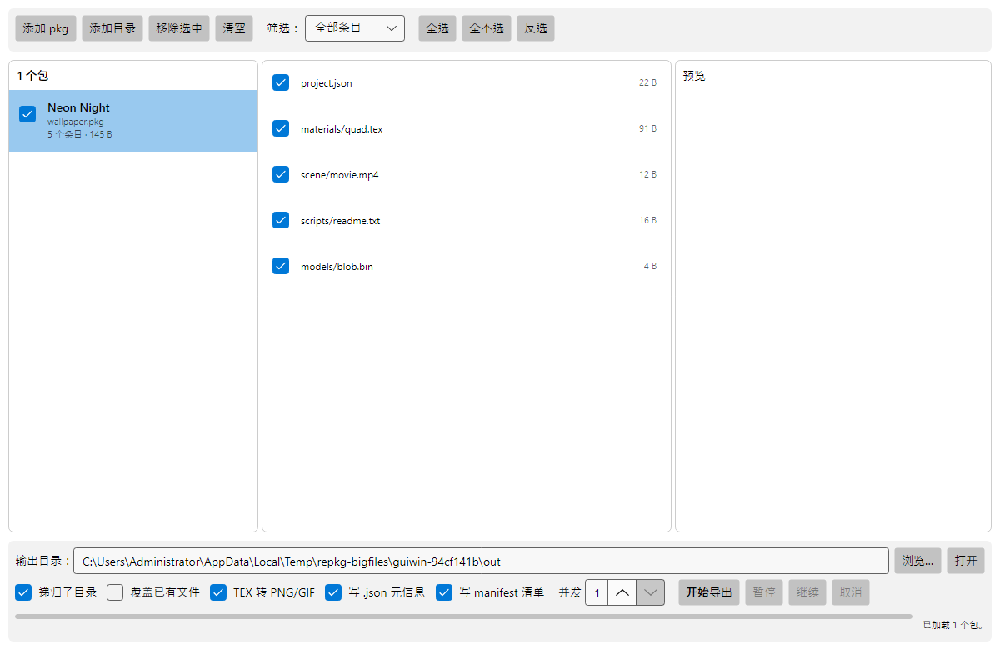
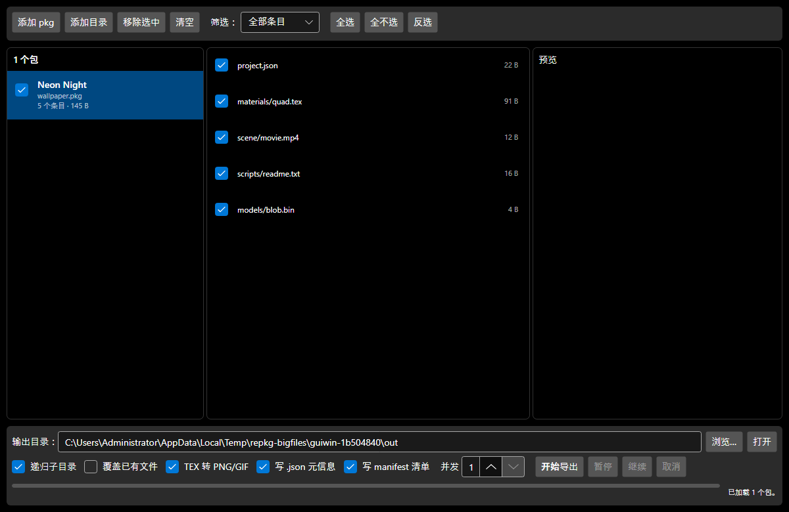

# RePKG-Enhanced

[English](README.md) | **简体中文**

**Wallpaper Engine `.pkg` 提取工具：大文件不崩、批量不卡、内存可控。**

[](https://github.com/dieraun/RePKG-Enhanced/releases)
[](https://github.com/dieraun/RePKG-Enhanced/actions/workflows/release.yml)
[](LICENSE)
[](#下载)
[](https://dotnet.microsoft.com/)

基于 [notscuffed/RePKG](https://github.com/notscuffed/RePKG)（MIT，已停更）做**最小必要改动**：修掉它「大文件提取失败」的根因，并补上一个跨平台的 Avalonia 桌面界面。
解析内核与导出队列只有一份，**CLI 与 GUI 共用**。



---

## 为什么需要它

Wallpaper Engine 的创意工坊包动辄几百 MB 到几 GB，原版 RePKG 在解析 pkg 时会这么干：

```csharp
private static void PopulateEntriesWithData(int dataStart, List<PackageEntry> entries, BinaryReader reader)
{
    foreach (var entry in entries)
    {
        reader.BaseStream.Seek(entry.Offset + dataStart, SeekOrigin.Begin);
        entry.Bytes = reader.ReadBytes(entry.Length);   // ← 整包所有条目一次性进内存
    }
}
```

于是**提取一个 5 MB 的贴图，也要先把整个 2 GB 的包读进内存**——32 位进程直接 OOM，64 位进程疯狂换页，大条目还会因为 `int` 偏移截断而读错位置。

RePKG-Enhanced 把**条目表与数据区彻底分离**：读表只记 `FullPath / Offset / Length`，提取时 `Seek` 到条目偏移，再用 1 MiB 缓冲**流式复制**到目标。峰值内存由缓冲区大小决定，与条目体积、包总体积**无关**。

### 实测数据

本机（Windows 10、7.9 GB 内存、SSD），`REPKG_BIG_TESTS=1` 门禁：

| 场景 | 包大小 | 提取耗时 | 托管分配增量 | 峰值工作集 | 输出校验 |
|---|---|---|---|---|---|
| 单条目 1 GiB | 1 073 741 867 B | 14.1 s | **1.0 MiB** | 40.2 MiB | SHA-256 与源逐字节一致 |
| 两个 1.1 GiB 条目 | 2 362 232 074 B | 20.9 s | **1.0 MiB** | 42.3 MiB | 同上 |

那 1.0 MiB 就是 `ArrayPool` 租的第一个缓冲区；**再大的包也不会让它变大**。原版路径下，同样场景需要至少「条目体积」级别的内存，2.2 GiB 的包在 32 位进程里必然失败。

<details>
<summary>门禁断言长什么样（点开）</summary>

```csharp
// 提取 1 GiB 条目，断言托管分配增量不随条目体积线性增长
var before = GC.GetTotalAllocatedBytes(precise: true);
EntryExtractor.CopyEntry(source, entry, destination, bufferSize: 1 << 20);
var allocated = GC.GetTotalAllocatedBytes(precise: true) - before;
Assert.True(allocated < 32 * 1024 * 1024);   // 实测 1.0 MiB
```

工作集只做打印、不做断言——7.9 GB 的机器上工作集受 OS 缓存与 GC 策略干扰，拿来做门禁会变成 flaky 测试。
</details>

---

## 核心特性

### 1. 大文件优先，条目不进内存
- 条目表与数据区分离，`ReadBytes(entry.Length)` 已从整条提取链路移除（`grep` 可验）。
- 单条提取走 `FileStream.Seek` + 1 MiB 分块复制；`RandomAccess.Read` 实现条目流，多线程可并行读同一个句柄。
- 源 pkg 以 `FileAccess.Read` + `FileShare.Read` 打开，**不锁死**其他读取方。
- 偏移按 **uint32** 解释、内部用 `long`：修掉原版 `int` 在 >2 GiB 包上的截断。

### 2. 批量导出：一个队列，失败隔离
- 目录递归 + 扩展名过滤（`-e/--onlyexts`、`-i/--ignoreexts`，与原版语义一致，`ignore` 优先）。
- 单一有界导出队列（`System.Threading.Channels`），并发数与队列上限都可配；**任一时刻只保留当前文件的一个流式读句柄**。
- 单条目失败记日志后继续，失败计数进入汇总与退出码；损坏的 pkg 不会拖垮整批。
- 暂停 / 取消在**条目边界**生效；取消后清理临时文件，已完成的条目默认保留。
- 输出**原子写入**（同目录临时文件 + `File.Move` 替换），中断不留半成品。

### 3. TEX / GIF / MP4：提取与预览
| 输入 | 输出 | 说明 |
|---|---|---|
| `TEX`（RGBA8888 / R8 / RG88 / DXT1·3·5 / LZ4） | `PNG` | SkiaSharp 解码；像素在 `TexToImageConverter` 里按 header 尺寸左上角裁剪 |
| 动画 `TEX`（`TEXS0001-0003` 帧表） | `GIF` | **自研 GIF89a 编码器**（LZW + 中位切分量化 + 逐帧局部色表），逐帧合成、写盘、释放，不物化全部帧 |
| 视频纹理（`FIF_MP4`） | `MP4` | 校验 `ftypisom/ftypmsnv/ftypmp42` 后透传 |
| 任意图片容器格式（`FIF_PNG` 等） | 原样 | 直接透传字节 |
| 每个 TEX | `.json` | Wallpaper Engine 的纹理元信息（`format`、flags、GIF 序列信息） |

`--no-tex-convert` 可关掉转换、导出原始 `.tex`——**超大条目请用它**：TEX 转换必须把该条目读进内存（单条上限 250 MB），纯流式导出没有这个限制。

### 4. GUI（Avalonia 12）
- 单/批量加载 pkg，拖拽导入；包列表 + 条目列表 + 预览三栏。
- **三态勾选**（全选 / 半选 / 全不选）双向传播，可按 图片 / 文本 / 视频 / 其它 筛选。
- 预览：TEX 直接渲染成图、文本文件带 64 KiB 截断提示、视频给出提示。
- 导出走**和 CLI 完全相同的队列与流式内核**，因此暂停、取消、失败隔离、进度全都有，没有第二套实现。
- 明暗主题跟随系统；XAML 全部编译进程序（AOT 要求），无动画、无云同步。



### 5. 单文件、零依赖
`repkg.exe`（13.7 MiB）与 `RePKG-Enhanced.exe`（35.4 MiB）都是 **NativeAOT 单文件**：.NET 运行时、SkiaSharp / HarfBuzz / ANGLE 的原生库全部内嵌，解压即用，目标机器不需要装 .NET。

---

## 下载

到 [Releases](https://github.com/dieraun/RePKG-Enhanced/releases/latest) 取最新 Windows x64 产物：

| 文件 | 说明 |
|---|---|
| `RePKG-Enhanced-win-x64.exe` | 图形界面版（约 35 MiB） |
| `repkg-win-x64.exe` | 命令行版（约 14 MiB） |
| `SHA256SUMS.txt` | 两个 exe 的 SHA-256 |

> **Windows 会拦一下，这是正常的。** 见下面的[注意事项](#注意事项与已知限制)。

---

## 命令行用法

```powershell
# 提取单个 pkg（TEX 自动转 PNG/GIF/MP4，并写 .json 元信息）
repkg extract wallpaper.pkg -o out

# 递归提取一个目录下所有 pkg，只要 tex 和 png
repkg extract D:\workshop -r -o out -e tex,png

# 超大包：只导原始条目，不做 TEX 转换（纯流式，内存恒定）
repkg extract huge.pkg --no-tex-convert -o out

# 每个 pkg 一个子目录，目录名取 project.json 的 title，附带复制 project.json，并写资源清单
repkg extract D:\workshop -r -n -c --manifest

# 用 project.json 的 title 给输出目录命名，并覆盖已有文件
repkg extract wallpaper.pkg -n --overwrite

# 查看清单（文本 / JSON）
repkg info wallpaper.pkg
repkg info wallpaper.pkg --json

# 单独转换一个 .tex
repkg tex quad.tex -o out
```

常用参数：

| 参数 | 作用 |
|---|---|
| `-o, --output <目录>` | 输出根目录（默认 `output`） |
| `-e, --onlyexts <列表>` / `-i, --ignoreexts <列表>` | 扩展名白/黑名单，逗号分隔，`ignore` 优先 |
| `-r, --recursive` | 目录输入时递归找 `*.pkg` |
| `-s, --singledir` | 不保留 pkg 内目录结构（单包内压平） |
| `-n, --usename` | 用 `project.json` 的 `title` 作输出子目录名 |
| `-c, --copyproject` | 同时写出 `project.json` |
| `--no-tex-convert` | 不转换 TEX，原样导出 `.tex` |
| `--overwrite` / `--no-log` / `--manifest` | 覆盖已有文件 / 不写日志 / 写资源清单 |
| `--concurrency <n>` / `--queue-capacity <n>` | 同时处理的包数（默认 1）/ 排队上限（默认 64） |

**退出码**：`0` 全部成功 · `1` 有失败项 · `2` 参数错误 · `130` 被用户中断。

> 与原版 CLI 的**有意差异**：批量时每个 pkg 导出到自己的子目录（原版摊平到同一目录，同名条目会互相覆盖）；不提供 `interactive` 子模式。`--help` 里写明了这两点。

### 导出产物

```
out\
  wallpaper\
    project.json               # -c 时复制
    scene.json
    materials\quad.png          # TEX 转出来的图
    materials\quad.json         # 纹理元信息
    scene\movie.mp4             # 视频纹理
    manifest.json               # --manifest 时的资源清单（条目表 + 偏移）
    export-log.jsonl            # 逐条目事件日志（默认写）
```

---

## 图形界面

1. 双击 `RePKG-Enhanced.exe`（首次启动会解压原生库，见注意事项）。
2. 「添加 pkg」/「添加目录」，或直接把 `.pkg` 拖进窗口。
3. 中间栏按需勾选条目，右上角筛选可只看图片/文本/视频；右侧实时预览。
4. 选输出目录 → 勾选选项（递归子目录 / 覆盖已有文件 / TEX 转 PNG·GIF / 写 .json 元信息 / 写 manifest 清单 / 并发数）→「开始导出」。
5. 导出中可「暂停 / 继续 / 取消」；进度条与状态栏显示当前包、当前条目、累计字节与失败数。

---

## 构建

需要 **.NET 10 SDK**（Windows 上做 AOT 发布还需要 MSVC C++ 工具链 + Windows SDK）。

```powershell
dotnet build RePKG-Enhanced.slnx -c Release

dotnet test tests\RePKG.Tests\RePKG.Tests.csproj -c Release
dotnet test tests\RePKG.Tests.Shared\RePKG.Tests.Shared.csproj -c Release
dotnet test tests\RePKG.Tests.Cli\RePKG.Tests.Cli.csproj -c Release
dotnet test tests\RePKG.Tests.Gui\RePKG.Tests.Gui.csproj -c Release

# 大文件门禁：会产生 GB 级中间文件，建议 ≥10 GB 空闲磁盘
$env:REPKG_BIG_TESTS = '1'
$env:REPKG_BIG_TMP   = 'D:\tmp\repkg-bigfiles'
dotnet test tests\RePKG.Tests.BigFiles -c Release
```

当前测试规模：`RePKG.Tests` 40 + `RePKG.Tests.Shared` 63 + `RePKG.Tests.Cli` 13 + `RePKG.Tests.Gui` 15 = **131 个单元/集成测试**，外加 2 个大文件门禁。

### 发布（Windows x64，NativeAOT 单文件）

```powershell
dotnet publish src\RePKG.Cli\RePKG.Cli.csproj -c Release -r win-x64 -o artifacts\cli
dotnet publish src\RePKG.Gui\RePKG.Gui.csproj -c Release -r win-x64 -o artifacts\gui
```

打 `v*` tag 会触发 [release.yml](.github/workflows/release.yml)：`windows-latest` 上 还原 → 编译 → 四套单测 → AOT 发布 → 校验「产物目录里不许有 DLL」→ 上传两个 exe 与 `SHA256SUMS.txt` 到 Release。

### 为什么不是 `PublishSingleFile`

`PublishAot` 与 `PublishSingleFile` 在 .NET 10 **无法共存**（[dotnet/runtime#117986](https://github.com/dotnet/runtime/discussions/117986)：原生 DLL 依旧躺在 exe 旁边），而 .NET 10 又取消了单文件应用在 exe 目录搜索原生库的行为。

所以本项目换了个路子：把 `libSkiaSharp.dll` / `libHarfBuzzSharp.dll` / `av_libglesv2.dll` 作为 `EmbeddedResource` **编进 exe**，启动时由 `NativeBootstrap` 解压到 `%LOCALAPPDATA%` 并 `NativeLibrary.Load` **预加载**；之后 SkiaSharp 的 `DllImport("libSkiaSharp")` 裸名加载会命中已加载模块，什么都不用改。

> 踩坑记录：MSBuild 里这个目标必须挂 `BeforeTargets="SplitResourcesByCulture"`。挂在 `PrepareResourceNames` 之前**已经太晚**——`SplitResourcesByCulture` 是它的依赖，会先把 `@(EmbeddedResource)` 快照走，资源被静默丢弃（现象：`repkg.dll` 只有 31 KB）。细节见 [docs/06-publish-and-ci.md](docs/06-publish-and-ci.md)。

---

## 项目结构

```
src/RePKG.Core         解析内核（netstandard2.0，上游代码最小改动）
src/RePKG.Application  流式读取、TEX 解码、GIF 编码（net10.0）
src/RePKG.Shared       导出队列、原子写入、路径校验、JSONL 日志、资源清单、原生库引导
src/RePKG.Cli          命令行入口（repkg）
src/RePKG.Gui          Avalonia 桌面入口
build/                 MSBuild 片段（原生库内嵌）
docs/                  各阶段报告与决策记录（ADR）
tests/                 单元测试 + 大文件门禁 + CLI/GUI 集成测试
```

依赖方向：`Core ← Application ← Shared ← {Cli, Gui}`。入口层只做「装配 + 呈现」，**不允许**出现第二套条目循环、路径校验或落盘逻辑。

## 依赖

| 依赖 | 版本 | 许可 | 用途 |
|---|---|---|---|
| [K4os.Compression.LZ4](https://github.com/MiloszKrajewski/K4os.Compression.LZ4) | 1.3.8 | MIT | TEX 的 LZ4 解压 |
| [SkiaSharp](https://github.com/mono/SkiaSharp) | 3.119.4 | MIT | 像素解码与 PNG 编码（与 Avalonia 后端同源） |
| [Avalonia](https://github.com/AvaloniaUI/Avalonia) | 12.1.4 | MIT | 跨平台 GUI |
| [CommunityToolkit.Mvvm](https://github.com/CommunityToolkit/dotnet) | 8.4.2 | MIT | 源生成 MVVM（AOT 友好） |

DXT1/3/5 解码是原版 RePKG 自带的托管实现，没有引入额外原生依赖。所有依赖都是 OSI 认可的宽松许可。

---

## 注意事项与已知限制

1. **未做代码签名，Windows 可能提示 SmartScreen 拦截。**
   首次运行 exe 时可能看到「Windows 已保护你的电脑」。点 **「更多信息」→「仍要运行」** 即可；也可以右键 exe →「属性」→ 勾选「解除锁定」。这是未签名分发的正常现象，不是文件损坏。发布页提供 `SHA256SUMS.txt`，可用 `Get-FileHash <exe> -Algorithm SHA256` 自行核对。
2. **首次启动会自解压原生库。**
   SkiaSharp / HarfBuzz / ANGLE 以资源形式内嵌在 exe 里，首次运行会解压到 `%LOCALAPPDATA%\RePKG-Enhanced\native\<版本>\`（CLI 约 11.6 MB，GUI 约 19 MB）。之后启动直接复用，没有额外开销。**升级版本会解压到新的版本目录，旧目录不会自动清理**，可手动删除。
3. **只提供 Windows x64 预编译产物。** 代码本身保持跨平台（`Core/Application/Shared` 与 GUI 都能在 Linux/macOS 上构建运行），但当前发布流水线只覆盖 Windows x64。
4. **TEX 转换需要整条读入内存。** 单条 mipmap 上限 250 MB（原版约束，防畸形包）。超大条目请用 `--no-tex-convert` 走纯流式导出——那条路径内存恒定。
5. **动画 GIF 是有损的**：≤255 色 + 1 个透明索引（自研量化器的取舍）；只支持 raw mipmap 格式的 TEX，与上游行为一致。
6. **包内路径上限从 255 字节放宽到 1024 字节**（原版超长路径会被静默截断）。若你依赖「截断后仍能导出」的旧行为，会有差异。
7. **产物里会有 `.pdb`**：AOT 编译产生，不随 Release 分发（Release 只挂 exe 与校验和）。
8. **不支持**：云同步、在线工坊下载、pkg 的**写回/重打包**、`interactive` 交互模式。
9. **没有真实工坊样本做过端到端回归**：测试用的 pkg 是合成样本（含畸形/截断/路径穿越/超大条目等用例）。遇到具体包解析异常，欢迎带 `repkg info` 的输出提 issue。
10. **界面与命令行输出目前只有中文**（CLI 参数名是英文）。英文版说明见 [README.md](README.md)；要做英文界面属于另一项工作，不在 v1.0.0 范围内。

---

## 特别鸣谢

- **[notscuffed/RePKG](https://github.com/notscuffed/RePKG)** —— 本项目的起点。pkg 格式、TEX 格式、DXT 解码、帧表解析等大量知识来自这个 MIT 项目；本项目对它的改动集中在「条目表 / 数据区分离」与「图像栈换 SkiaSharp」，其余尽量保持原样。原版许可证见 [LICENSE-RePKG](LICENSE-RePKG)。
- [Avalonia](https://github.com/AvaloniaUI/Avalonia)、[SkiaSharp](https://github.com/mono/SkiaSharp)、[K4os.Compression.LZ4](https://github.com/MiloszKrajewski/K4os.Compression.LZ4)、[CommunityToolkit](https://github.com/CommunityToolkit/dotnet) —— 撑起 GUI 与图像/压缩的底座。
- 以及所有逆向过 Wallpaper Engine 包格式、并把结论公开出来的人。

## 许可

[MIT](LICENSE)。逐文件改动点在源文件头部注释里标注「基于 notscuffed/RePKG (MIT) 二次修改」；决策与取舍记录在 [docs/DECISIONS.md](docs/DECISIONS.md)。

## 文档

| 文档 | 内容 |
|---|---|
| [阶段 0：事实核查与根因](docs/00-stage0-fact-check.md) | 原版缺陷逐行定位、发布策略选型的实测依据 |
| [阶段 1：目录与文件清单](docs/01-file-inventory.md) | 哪些文件原样保留、哪些修改、哪些新增 |
| [阶段 2：流式内核](docs/02-streaming-core.md) | 条目表/数据区分离、1 GiB & 2.2 GiB 门禁数据 |
| [阶段 3：Shared 层](docs/03-shared-layer.md) | 导出队列、原子写入、路径穿越防御、JSONL 日志 |
| [阶段 4：TEX 栈与 CLI](docs/04-cli-and-textures.md) | SkiaSharp 迁移、自研 GIF 编码器、CLI 语义 |
| [阶段 5：GUI 与清单](docs/05-gui.md) | Avalonia 12 界面、无头渲染测试、manifest |
| [阶段 6：发布与 CI](docs/06-publish-and-ci.md) | AOT 单文件方案、内嵌原生库、Release 流水线 |
| [决策记录](docs/DECISIONS.md) | 20 条 ADR：每个"为什么不那样做" |
