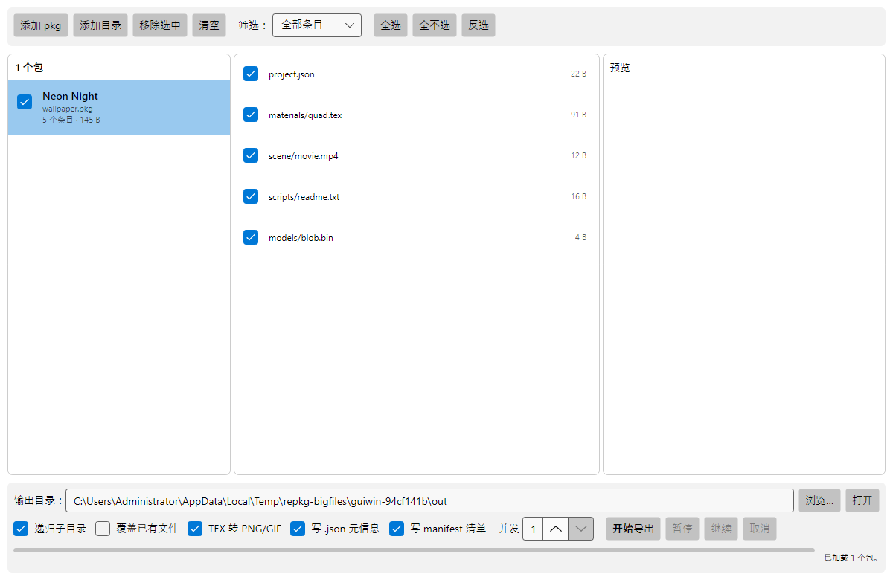
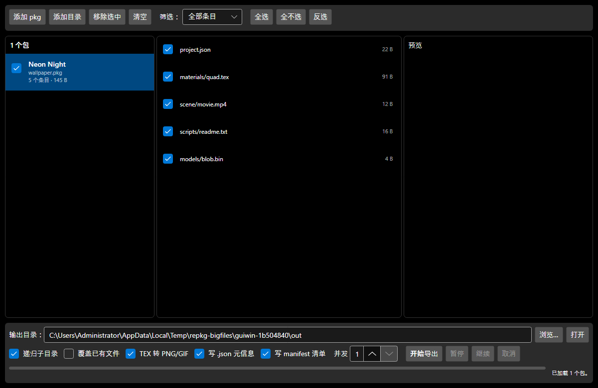

# 阶段 5 · RePKG.Gui（Avalonia 12）

状态：**待用户验收**
分支/提交：见本文件末尾「提交记录」
上游基线：`notscuffed/RePKG`（MIT，`8005eb2` 2025-03-12）
本阶段新增/修改的代码全部逐文件标注「基于 notscuffed/RePKG (MIT) 二次修改」。

---

## 1. 目标核对（阶段 5 说明书要求 → 实现）

| 要求 | 实现位置 | 证据 |
|---|---|---|
| 单/批量加载 pkg | `src\RePKG.Gui\ViewModels\MainWindowViewModel.cs:171` `LoadAsync`、`:163` `CollectPackages` | `MainWindowViewModelTests.LoadAsync_PopulatesPackagesAndEntries`、`LoadAsync_DeduplicatesAndSkipsCorruptPackages` |
| 拖拽导入 | `src\RePKG.Gui\Views\MainWindow.axaml:11` `DragDrop.AllowDrop="True"`、`Views\MainWindow.axaml.cs:29` `OnDrop` | `MainWindowTests.Drop_PackageFile_LoadsItThroughTheRealDragDropPath`（走真实 `RawDragEventType.Drop`） |
| 清单/条目列表 + 三态勾选 | `ViewModels\PackageViewModel.cs`（`bool? IsSelected`、`RefreshSelectionState`）、`EntryViewModel.cs` | `MainWindowViewModelTests.Selection_PropagatesBetweenPackageAndEntries` |
| 按图片/文本/视频分类筛选 | `ViewModels\EntryKind.cs`、`MainWindow.axaml:25` 筛选 ComboBox、VM `RefreshVisibleEntries` `:362` | `MainWindowViewModelTests.Filter_HidesEntriesOfOtherKinds`（5 类条目 × 5 个筛选档） |
| TEX/图片/文本预览 | `Services\PreviewService.cs`（.tex→PNG 走 `TexToImageConverter.WriteTo`；文本 ≤64 KiB） | `MainWindowViewModelTests.Preview_ShowsTextAndImage` |
| 自定义输出目录 | `MainWindow.axaml` 输出目录行 + VM `ChooseOutputAsync` | `MainWindowViewModelTests.AddFolderCommand_UsesDialogAndRecursionSetting` |
| 导出任务队列（与 CLI 同一实现） | `src\RePKG.Shared\Export\ExportQueue.cs`；GUI 只做 `entrySelector` 传入（VM `:483`） | `Export_WritesOnlySelectedEntriesIntoPerPackageFolder`、`Export_ConvertsTexAndWritesJson`；ADR-013/016 |
| 暂停 / 继续 / 取消 | VM `PauseCommand/ResumeCommand/CancelCommand` → `ExportQueue.Control` | `Cancel_StopsExportAndLeavesNoTemporaryFiles`（断言无 `.tmp` 残留） |
| 明暗主题跟随系统 | `src\RePKG.Gui\App.axaml` `RequestedThemeVariant="Default"` + `<FluentTheme/>` | `MainWindowTests.MainWindow_RendersBothThemeVariants`（截图见 `docs\images\`） |
| 导出日志 | `ExportQueue` 每包 `export-log.jsonl`（阶段 3 已实现，GUI 复用） | `ExtractsEntriesAndWritesLog`（CLI）、`WriteManifest_EmitsEntryTableJson`（Shared） |
| 资源清单 | `src\RePKG.Shared\Catalog\PackageManifest.cs`；CLI `--manifest`、GUI「写 manifest 清单」 | Shared/CLI/GUI 三处测试 |
| TEX 转 PNG/GIF | 阶段 4 的 `TexEntryConverter`（`IEntryConverter`）；GUI 勾选框 `ConvertTex` | `Export_ConvertsTexAndWritesJson` |
| 禁止冗余动画 / 云同步 / 臃肿依赖 | XAML 无 `Transition`/`Animation`；无网络代码 | `grep -i "transition\|animation\|HttpClient"` 无命中 |

---

## 2. 逐文件改动（本阶段）

**新增（`src\RePKG.Gui`，全部为本项目原创，未从上游复制）**

| 文件 | 职责 |
|---|---|
| `RePKG.Gui.csproj` | net10.0、`WinExe`、`IsAotCompatible`、`BuiltInComInteropSupport=false`、`AvaloniaUseCompiledBindingsByDefault=true` |
| `Program.cs` | `[STAThread] Main` → `BuildAvaloniaApp().StartWithClassicDesktopLifetime(args)` |
| `App.axaml` / `App.axaml.cs` | `RequestedThemeVariant="Default"`（跟随系统）+ Fluent 主题；组合根：MainWindow + `StorageDialogService` + `MainWindowViewModel` |
| `Services\IDialogService.cs` / `StorageDialogService.cs` | 文件/目录选择与「在文件管理器中显示」；真实现用 `IStorageProvider`，测试用 fake |
| `Services\PreviewService.cs` | 预览数据装配（文本截断、.tex→PNG 字节） |
| `ViewModels\MainWindowViewModel.cs`（618 行） | 全部交互逻辑：加载、勾选三态、筛选、预览、导出、暂停/取消 |
| `ViewModels\PackageViewModel.cs` / `EntryViewModel.cs` | 包与条目的可观察模型（三态 `bool?`） |
| `ViewModels\EntryKind.cs` / `ByteSize.cs` | 分类与容量格式化 |
| `Views\MainWindow.axaml`（162 行）/ `MainWindow.axaml.cs` | 三栏布局 + 底栏三行；拖拽事件接 `DataTransfer.TryGetFiles()` |

**修改（Shared / CLI，为 GUI 复用而做的最小增量）**

| 文件 | 改动 |
|---|---|
| `src\RePKG.Shared\Export\ExportQueue.cs` | `EnqueueAsync`/`EnqueueManyAsync` 增 `Func<PackageEntry,bool>? entrySelector`（VM 传勾选集合，**GUI 不复制条目循环**）；`WriteManifest` 后置写 `manifest.json` |
| `src\RePKG.Shared\Export\ExportOptions.cs` | 新增 `WriteManifest`（默认 false） |
| `src\RePKG.Shared\Catalog\PackageManifest.cs` | 新增：清单 JSON 唯一实现，`info --json` 与 `extract --manifest` 共用 |
| `src\RePKG.Cli\Cli\{CliOptions,CliParser,HelpText}.cs`、`Commands\{ExtractCommand,InfoCommand}.cs` | `--manifest`；`InfoCommand` 改为调用 `PackageManifest.ToJson` |
| `Directory.Packages.props` | `Avalonia 12.1.4`、`Avalonia.Desktop`、`Avalonia.Themes.Fluent`、`CommunityToolkit.Mvvm 8.4.2`、`Avalonia.Headless.XUnit 12.1.4` |

**新增测试工程**

| 文件 | 内容 |
|---|---|
| `tests\RePKG.Tests.Gui\RePKG.Tests.Gui.csproj` | net10.0 Exe + xunit.v3 + `Avalonia.Headless.XUnit 12.1.4` |
| `tests\RePKG.Tests.Gui\TestAppBuilder.cs` | `UseHeadless(new AvaloniaHeadlessPlatformOptions { UseHeadlessDrawing = false }).UseSkia()`（走真实 Skia 才能截图/解码） |
| `tests\RePKG.Tests.Gui\MainWindowViewModelTests.cs` | 12 项：加载/去重/坏包、筛选、三态勾选、导出（结构、TEX 转换、manifest）、暂停/取消、集合增删、目录对话框、预览 |
| `tests\RePKG.Tests.Gui\MainWindowTests.cs` | 4 项（含 theory）：窗口渲染、明暗两套主题截图、真实拖拽事件路径 |

---

## 3. 编译与测试命令（实测）

```powershell
cd D:\BetterRePKG

# 1) 全量编译
dotnet build RePKG-Enhanced.slnx -c Release
# → Build succeeded. 5 Warning(s)（仅测试项目 xUnit1051），0 Error(s)，约 1m22s

# 2) GUI 无头测试（含真实 Skia 渲染与截图）
dotnet test tests\RePKG.Tests.Gui -c Release
# → Passed! Failed: 0, Passed: 15, Total: 15, Duration: 19 s

# 3) 其余三套（回归）
dotnet test tests\RePKG.Tests        -c Release   # → Passed: 40
dotnet test tests\RePKG.Tests.Shared -c Release   # → Passed: 63
dotnet test tests\RePKG.Tests.Cli    -c Release   # → Passed: 13

# 4) 大文件门禁（重跑，确认 GUI 阶段没碰坏流式内核）
$env:REPKG_BIG_TESTS=1; $env:REPKG_BIG_TMP='D:\BetterRePKG\.bigtmp'
dotnet test tests\RePKG.Tests.BigFiles -c Release
# → Passed: 2（1 GiB 单条目 + 2.2 GiB 包，分配增量 1.0 MiB）

# 5) 真实 GUI 冒烟（人工）
dotnet run --project src\RePKG.Gui -c Release
```

实测汇总（2026-10-31）：

| 套件 | 结果 |
|---|---|
| `RePKG.Tests` | 40 passed |
| `RePKG.Tests.Shared` | 63 passed |
| `RePKG.Tests.Cli` | 13 passed |
| `RePKG.Tests.Gui` | 15 passed |
| `RePKG.Tests.BigFiles`（门禁） | 2 passed，3 m 35 s |
| 合计 | **133 passed / 0 failed** |

截图产物（由无头测试真实渲染，非手绘 moke，随仓库提交在 `docs\images\`）：





- `docs\images\main-window-light.png`（1200×780）
- `docs\images\main-window-dark.png`（1200×780）

---

## 4. 验收点对照

| # | 验收点 | 结果 |
|---|---|---|
| 1 | 单/批量加载 pkg，清单可读 | ✅ 单元测试 + 截图（「1 个包 / 5 个条目 / 145 B」） |
| 2 | 三态勾选（全选/半选/全不选）双向传播 | ✅ `Selection_PropagatesBetweenPackageAndEntries` |
| 3 | 筛选（全部/图片/文本/视频/其它） | ✅ `Filter_HidesEntriesOfOtherKinds` |
| 4 | 预览（TEX→PNG、文本、视频提示） | ✅ `Preview_ShowsTextAndImage` |
| 5 | 导出走 CLI 同一 `ExportQueue`，逐条目勾选生效 | ✅ `Export_WritesOnlySelectedEntriesIntoPerPackageFolder`；`ExportQueueTests` 共用实现 |
| 6 | 暂停/取消在条目边界生效，无 `.tmp` 残留 | ✅ `Cancel_StopsExportAndLeavesNoTemporaryFiles` |
| 7 | 拖拽导入 | ✅ `Drop_PackageFile_LoadsItThroughTheRealDragDropPath` |
| 8 | 明暗主题跟随系统 | ✅ `main-window-{light,dark}.png`，亮度断言 |
| 9 | 输出目录可自定义 + 打开 | ✅ `ChooseOutputAsync` / `RevealOutput` |
| 10 | 无动画、无云同步、依赖最小 | ✅ XAML 无动画；新增依赖仅 Avalonia 栈 + CommunityToolkit.Mvvm（源生成，AOT 友好） |

---

## 5. 本阶段修掉的问题（都是真问题，不是测试凑数）

1. **取消后状态文案错误**：`ExportSummary.IsSuccess` 只看 `Failed == 0`，于是「取消了 24 个条目」被显示成「导出完成：0 个文件」。→ VM 先把 `Canceled > 0` 单独分支出来（`ViewModels\MainWindowViewModel.cs:487` 附近），文案改为「已取消：成功/跳过/失败/取消（已完成的条目已保留）」。
2. **Avalonia 12 拖拽 API 迁移**：`DragEventArgs.Data` + `DataFormats.Files` 在 12 已移除（`CS0619`）。→ 改用 `e.DataTransfer.TryGetFiles()`（`IDataTransfer` 扩展方法），`DataTransferItem.CreateFile` 用于测试侧构造。
3. **`Application` 命名冲突**：本项目命名空间 `RePKG.Application` 会遮蔽 `Avalonia.Application`，`App : Application` 报 `CS0118`。→ 显式写 `Avalonia.Application`。
4. **布局被裁切**：首版底栏用 `WrapPanel ItemHeight="34"`，「并发」被挤到第二行并截断（截图可见）。→ 重建工具栏/底栏为三行结构，截图复核通过。
5. **`ExportQueue` 日志句柄泄漏**（阶段 3 发现、本阶段复用路径再次覆盖）：`_sharedLogs` 未随队列释放 → 测试里 `export-log.jsonl` 被占用。→ `DisposeAsync` 统一关闭。

---

## 6. 已知限制

1. **视频预览只显示提示**（不内嵌播放器）：条目体积可能很大且需要解码器，属于「臃肿依赖」，按功能规范不引入。
2. **大包清单加载是全量元数据**：`PackageFileSource.Open` 会读完整条目表（只读元数据，不碰数据区）。10 万条目级别的包会占用可观内存（每条 ≈ 100 B 级）；阶段 0 已确认这是可接受口径，未做分页。
3. **预览是 fire-and-forget**：快速连点条目时只保留最后一次结果（VM 用 token 丢弃过期结果），预览无进度条。
4. **并发上限硬编码 1–4**：GUI 用 `Math.Clamp(Concurrency, 1, 4)`，CLI 可到任意值；GUI 不放开的理由是笔记本上 >4 个并发读写同一磁盘只会更慢。
5. **`manifest.json` 写失败只记警告**：不把 job 判失败（清单是「包内容快照」，不是导出产物），因此失败时用户只会在日志里看到 `manifest.failed`。
6. **无头测试不能替代真机**：Linux/macOS 的字体、窗口装饰、文件管理器「显示」行为未在本机验证（阶段 6 由 CI 覆盖构建，交互仍需人工）。
7. **AOT 与 GUI**：`IsAotCompatible=true` 且阶段 0 的探针已证明 Avalonia 12 + SkiaSharp 可 AOT 发布，但**完整 GUI 的 AOT 发布要到阶段 6 才实跑**（本阶段只保证 `dotnet build` 与无头测试）。

---

## 7. 决策记录（本阶段新增 ADR，详见 `docs\DECISIONS.md`）

- **ADR-016**：GUI 通过 `ExportQueue.EnqueueAsync(entrySelector:)` 复用导出内核，不在 GUI 里写条目循环。理由：功能规范要求「CLI 与 GUI 共用同一流式内核与导出队列」，selector 是唯一需要的差异点（勾选集合）。
- **ADR-017**：`manifest.json` 归 `RePKG.Shared/Catalog`，CLI 与 GUI 共用。理由：清单是包的属性，不是导出器的属性；两处各写一份必然格式漂移（`info --json` 与 `extract --manifest` 必须同构）。
- **ADR-018**：Avalonia 12 拖拽迁移到 `IDataTransfer`/`DataFormat`（`DataFormats` 已废弃）；测试用 `RawDragEventType.Drop` 走真实事件链而不是直接调 VM。

---

## 8. 阶段 6 计划（下一步）

1. `docs\06-release.md`：三平台产物形态（Win/Linux 单文件 + macOS `.app`）与阶段 0 的 B′ 方案一致。
2. `build\publish.ps1`：`win-x64`/`linux-x64`/`linux-arm64`/`osx-x64`/`osx-arm64` 的 `PublishAot` + 原生库自解压引导（`NativeBootstrap`）。
3. GitHub Actions：三平台矩阵构建 + 产物上传 + `REPKG_BIG_TESTS` 冒烟（小尺寸版本，避免 CI 磁盘爆掉）。
4. 发布前检查：`LICENSE`/`LICENSE-RePKG`/`THIRD-PARTY-NOTICES.txt` 齐全，逐文件版权标注齐全。

---

## 提交记录

- 本阶段代码与测试：见仓库 git 历史中 `stage5:` 提交（`docs\05-gui.md` 与代码同批提交）。
